<!-- SPDX-License-Identifier: MIT -->
<!-- Copyright (c) 2026 commercetools GmbH. Freely available, AS IS and UNSUPPORTED. -->

# Dependency plan A → Z

Letters are in a valid **build order**: every workstream depends only on earlier letters. `plans/verify-plan.mjs` checks this, checks that every spec under `openspec/specs/**` that this project owns is implemented by at least one workstream (a spec listed in one workstream is primary there; a spec listed in several must be first in exactly one), and regenerates the graph and waves below. Status: **DRAFT v2** (2026-10-12, owner interview folded in; see `DECISIONS.md` D-028 to D-049).

**Owner scope changes of 2026-10-12 that shaped this table.** Wholesale buying from Malva is out of scope (Q-V01): the four specs `sp/design-quick-order-and-cart`, `sp/design-orders-quotes-invoices`, `sp/design-approvals-and-roles` and `sp/design-price-lists-and-saved-lists` carry the marker `<!-- OUT-OF-SCOPE -->` and are not required by the verifier; the old workstream V (wholesale) was removed. **Letters stay A to Z**: the old W (customers, returns, marketing, bundles, brand) was split, so the new **V** holds customers, subscriptions, returns and reviews, and the new **W** holds marketing, email, bundles, product import and brand partnership. X lost the MAP floor and territory attacks (Q-T03, Q-O03). The portal has two roles, Admin and Buyer (no Approver: no remaining spec needs it). No emails are sent (Q-P01), payments run through hosted commercetools Checkout with the Stripe connector (Q-012), subscriptions are sold fully (Q-Q06), all prices are standalone prices (Q-003).

Spec ids are shortened: `cs/` = `openspec/specs/consumer-storefront/`, `sp/` = `openspec/specs/seller-portal/`. Apps: `storefront/` (shopper, multi-tenant by URL path `/[locale]/[store]`) and `portal/` (partner portal). Seed package: `seed/`.

## Workstreams

| ID | Workstream | Implements (primary first) | Depends on | Owner prerequisites | Parallel with |
| --- | --- | --- | --- | --- | --- |
| A | Scaffold both apps, tooling, quality gate | cs/bootstrap-and-structure, sp/bootstrap-and-structure | — | — | — |
| B | Design tokens and fonts (both kits, lint) | *(token hooks of both bootstrap specs)* | A | — | C, D |
| C | Locale routing and messages (de-DE, en-US) | *(locale parts of both bootstrap specs)* | A | — | B, D |
| D | Seed 1: framework, project settings, sample-data cleanup, platform model | *(SEED-PLAN)* | A | OA-01 | B, C |
| E | Seed 2: parts catalog, fitment, images, prices, stock | *(SEED-PLAN)* | D | OA-04 | G |
| F | Seed 3: stores, business units, roles, selections, customers, discounts | *(SEED-PLAN)* | E | — | G |
| G | BFF core: commercetools clients, session, health | *(session and client parts of both bootstrap specs)* | A, C | OA-01 | E, F |
| H | Contentools integration and theme adapter | cs/theming-design | B, G | OA-02 | — |
| I | Storefront shell and store picker | cs/design-storefront-shell, cs/design-store-picker | B, C, F, G, H | — | — |
| J | Vehicle finder and garage | cs/design-vehicle-finder-and-garage | E, I | — | R |
| K | Home page (Puck) | cs/design-home-page | H, I, J | — | L, R |
| L | Product listing and search | cs/design-product-listing-page | E, F, I, J | — | K, R |
| M | Product detail page | cs/design-product-detail-page | L | — | R |
| N | Cart | cs/design-cart-page | M | — | R |
| O | Checkout | cs/design-checkout-page | N | OA-05 | R |
| P | Order confirmation and emails | cs/design-order-confirmation-page | O | — | R, S |
| Q | Shopper account area | cs/design-account-area, cs/design-demo-login, cs/design-auto-verify-registration | G, I, P | — | S, T |
| R | Portal shell, navigation and auth | sp/design-portal-shell-and-navigation, sp/design-auth-screens, sp/design-demo-login, sp/design-auto-verify-registration | B, F, G | — | J–P |
| S | Portal dashboard | sp/design-dashboard | R | — | P, Q, T, U |
| T | Portal catalog: assortment, price overrides, tailoring, discounts | sp/design-catalog-assortment, sp/design-price-overrides-and-margin, sp/design-product-info-tailoring, sp/design-discounts-and-priority | E, F, R | — | Q, S, U |
| U | Portal theme, content, store, channels, company | sp/design-storefront-theme-and-branding, sp/design-content-pages, sp/design-store-and-channels, sp/design-company-and-account | F, H, R | OA-02 | S, T, V, W |
| V | Portal customers, subscriptions, returns and reviews | sp/design-customers-and-subscriptions, sp/design-returns-and-reviews | F, P, Q, R | M-V-02 | U, W |
| W | Portal marketing, bundles, product import, brand partnership | sp/design-marketing-and-email, sp/design-bundles-and-product-import, sp/design-brand-partnership | P, R, T | — | U, V |
| X | Security hardening (roles, IDOR, CSRF, Contentools proxy, JWT leakage, order, return and review integrity) | *(cross-cutting)* | O, T, U, V, W | — | Y |
| Y | Accessibility, responsive and performance sweep | *(cross-cutting)* | K, L, M, N, O, P, Q, S, U, V, W | SO-01 | X |
| Z | Release readiness and final verification | all | A–Y | all OA, SO | — |

## Graph

```mermaid
graph LR
  A["A Scaffold both apps, tooling, quality gate"] --> B["B Design tokens and fonts (both kits, lint)"]
  A["A Scaffold both apps, tooling, quality gate"] --> C["C Locale routing and messages (de-DE, en-US)"]
  A["A Scaffold both apps, tooling, quality gate"] --> D["D Seed 1: framework, project settings, sample-"]
  D["D Seed 1: framework, project settings, sample-"] --> E["E Seed 2: parts catalog, fitment, images, pric"]
  E["E Seed 2: parts catalog, fitment, images, pric"] --> F["F Seed 3: stores, business units, roles, selec"]
  C["C Locale routing and messages (de-DE, en-US)"] --> G["G BFF core: commercetools clients, session, he"]
  B["B Design tokens and fonts (both kits, lint)"] --> H["H Contentools integration and theme adapter"]
  G["G BFF core: commercetools clients, session, he"] --> H["H Contentools integration and theme adapter"]
  F["F Seed 3: stores, business units, roles, selec"] --> I["I Storefront shell and store picker"]
  H["H Contentools integration and theme adapter"] --> I["I Storefront shell and store picker"]
  I["I Storefront shell and store picker"] --> J["J Vehicle finder and garage"]
  J["J Vehicle finder and garage"] --> K["K Home page (Puck)"]
  J["J Vehicle finder and garage"] --> L["L Product listing and search"]
  L["L Product listing and search"] --> M["M Product detail page"]
  M["M Product detail page"] --> N["N Cart"]
  N["N Cart"] --> O["O Checkout"]
  O["O Checkout"] --> P["P Order confirmation and emails"]
  P["P Order confirmation and emails"] --> Q["Q Shopper account area"]
  B["B Design tokens and fonts (both kits, lint)"] --> R["R Portal shell, navigation and auth"]
  F["F Seed 3: stores, business units, roles, selec"] --> R["R Portal shell, navigation and auth"]
  G["G BFF core: commercetools clients, session, he"] --> R["R Portal shell, navigation and auth"]
  R["R Portal shell, navigation and auth"] --> S["S Portal dashboard"]
  R["R Portal shell, navigation and auth"] --> T["T Portal catalog: assortment, price overrides,"]
  H["H Contentools integration and theme adapter"] --> U["U Portal theme, content, store, channels, comp"]
  R["R Portal shell, navigation and auth"] --> U["U Portal theme, content, store, channels, comp"]
  Q["Q Shopper account area"] --> V["V Portal customers, subscriptions, returns and"]
  R["R Portal shell, navigation and auth"] --> V["V Portal customers, subscriptions, returns and"]
  P["P Order confirmation and emails"] --> W["W Portal marketing, bundles, product import, b"]
  T["T Portal catalog: assortment, price overrides,"] --> W["W Portal marketing, bundles, product import, b"]
  U["U Portal theme, content, store, channels, comp"] --> X["X Security hardening (roles, IDOR, CSRF, Conte"]
  V["V Portal customers, subscriptions, returns and"] --> X["X Security hardening (roles, IDOR, CSRF, Conte"]
  W["W Portal marketing, bundles, product import, b"] --> X["X Security hardening (roles, IDOR, CSRF, Conte"]
  K["K Home page (Puck)"] --> Y["Y Accessibility, responsive and performance sw"]
  S["S Portal dashboard"] --> Y["Y Accessibility, responsive and performance sw"]
  U["U Portal theme, content, store, channels, comp"] --> Y["Y Accessibility, responsive and performance sw"]
  V["V Portal customers, subscriptions, returns and"] --> Y["Y Accessibility, responsive and performance sw"]
  W["W Portal marketing, bundles, product import, b"] --> Y["Y Accessibility, responsive and performance sw"]
  X["X Security hardening (roles, IDOR, CSRF, Conte"] --> Z["Z Release readiness and final verification"]
  Y["Y Accessibility, responsive and performance sw"] --> Z["Z Release readiness and final verification"]
```

<!-- GRAPH:BEGIN (generated by plans/verify-plan.mjs --sync) -->

Transitive edges are omitted (an edge is drawn only when no other dependency of the target already reaches the source).
<!-- GRAPH:END -->

## Critical path
`A → C → G → H → I → J → L → M → N → O → P → Q → … → X → Z`. The portal lane (R → T → W, with R → V beside it) runs in parallel with the shopper lane once F, G and B are done (see the generated waves table for the exact wave). Seed workstreams D → E → F start **right after A**; every data-driven page needs the seeded catalog.

## Parallel lanes (when more than one junior is available)

<!-- WAVES:BEGIN (generated by plans/verify-plan.mjs --sync) -->
| Wave | Can start when | Workstreams (run in parallel) |
| --- | --- | --- |
| 1 | immediately | **A** Scaffold both apps, tooling, quality gate |
| 2 | all of wave 1 they depend on are Done | **B** Design tokens and fonts (both kits, lint) **C** Locale routing and messages (de-DE, en-US) **D** Seed 1: framework, project settings, sample-data cleanup, platform model |
| 3 | all of wave 2 they depend on are Done | **E** Seed 2: parts catalog, fitment, images, prices, stock **G** BFF core: commercetools clients, session, health |
| 4 | all of wave 3 they depend on are Done | **F** Seed 3: stores, business units, roles, selections, customers, discounts **H** Contentools integration and theme adapter |
| 5 | all of wave 4 they depend on are Done | **I** Storefront shell and store picker **R** Portal shell, navigation and auth |
| 6 | all of wave 5 they depend on are Done | **J** Vehicle finder and garage **S** Portal dashboard **T** Portal catalog: assortment, price overrides, tailoring, discounts **U** Portal theme, content, store, channels, company |
| 7 | all of wave 6 they depend on are Done | **K** Home page (Puck) **L** Product listing and search |
| 8 | all of wave 7 they depend on are Done | **M** Product detail page |
| 9 | all of wave 8 they depend on are Done | **N** Cart |
| 10 | all of wave 9 they depend on are Done | **O** Checkout |
| 11 | all of wave 10 they depend on are Done | **P** Order confirmation and emails |
| 12 | all of wave 11 they depend on are Done | **Q** Shopper account area **W** Portal marketing, bundles, product import, brand partnership |
| 13 | all of wave 12 they depend on are Done | **V** Portal customers, subscriptions, returns and reviews |
| 14 | all of wave 13 they depend on are Done | **X** Security hardening (roles, IDOR, CSRF, Contentools proxy, JWT leakage, order, return and review integrity) **Y** Accessibility, responsive and performance sweep |
| 15 | all of wave 14 they depend on are Done | **Z** Release readiness and final verification |

Waves are topological levels: a workstream sits one wave after its latest dependency. A workstream may start earlier than its wave only if all its own dependencies are Done.
<!-- WAVES:END -->

## Gates (what must be true before the next wave)

| Gate | Condition | Checked by |
| --- | --- | --- |
| G1 after A | clean clone → `npm ci` → `npm run check` → `npm run build` green in `storefront/` and `portal/` | Claude |
| G2 after D | sample data gone, project key and settings (search indexing on, country tax fallback on) read back through the `b2b2c-automotive` MCP; seed `verify` green | Claude (MCP) |
| G3 after F | seeded parts, 2 resellers with different assortment, prices and branches read back through the MCP; Product Search returns the parts | Claude (MCP) |
| G4 after H | storefront renders the seeded theme from Contentools for two store keys and falls back to `default`; no console errors | Claude (Chrome) |
| G5 after I | shell, store picker and theme on every page at 375 and 1440 px | Claude (Chrome) |
| G6 after L | fit, non-fit and no-vehicle listing correct for three vehicles | Claude (Chrome + MCP) |
| G7 after P | browse → cart → checkout → confirmation round trip; the order exists in the project | Claude (Chrome + MCP) |
| G8 after R | partner sign-in, role-based navigation for Admin and Buyer | Claude (Chrome) |
| G9 after T | a reseller price above zero is accepted (standalone price on the store channel) and shows on the storefront, zero or negative is rejected by the server; assortment changes and tailored text and images show at once | Claude (Chrome + MCP) |
| G10 after X | role, IDOR and CSRF attacks fail server-side; proxy never leaks the JWT; order, return and review integrity attacks fail | Claude (Chrome + curl) |
| G11 after Z | every `TODO-MANUAL-TESTING.md` row is done or waived by the owner | Claude + owner |

## What blocks what (owner prerequisites, in the order needed)

1. **OA-01** seed/admin API client in `seed/.env.local` and the same project key for the apps (before D can run live). Never paste secrets in chat.
2. **OA-02** the `multitenant contentools` Merchant Center app installed and connected, so the Contentools JWT custom object exists (before H).
3. **OA-03** Image source reachable: the image GET is behind Cloudflare from this environment (HTTP 403); run `seed:images` once from a machine that can reach it, or supply the build id (before images in E).
4. **OA-04** decision on the plate/VIN provider (open question B), only if lookup beyond make/model/year is wanted in J.
5. **OA-05** Stripe test account, the Stripe connector and the commercetools Checkout application configured in the project (owner decision Q-012, full hosted Checkout flow with Stripe behind it) before O can run live; subscriptions (recurring orders through Checkout) need the same setup.
6. **SO-01** sign-off on screens missing from the designs (design.md §6).

Exact steps: `TODO-MANUAL-TESTING.md`.
